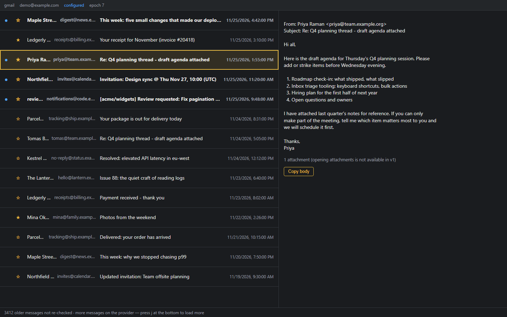
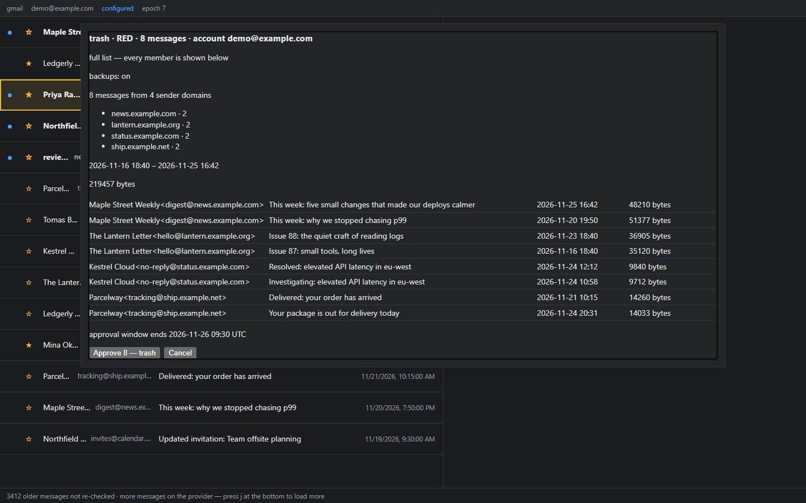
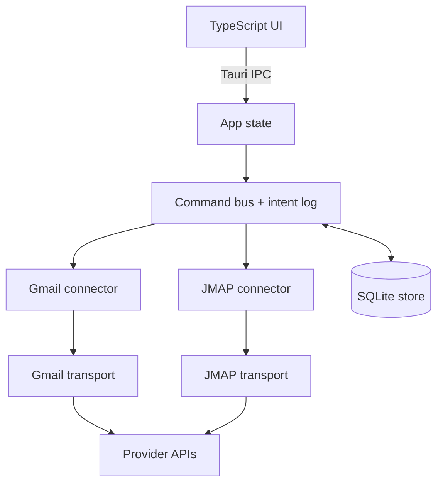

<div align="center">

<picture>
  <source media="(prefers-color-scheme: dark)" srcset="docs/assets/photon-banner-dark.svg">
  
</picture>


<!-- add the CI badge once the public repo's workflow has run green -->

</div>

<p align="center">
  
  <br><sub>The inbox view, drawn by the app's own rendering code with sample data.</sub>
</p>

> [!IMPORTANT]
> Photon is in early development. It reads real Gmail accounts today, but actions on live mail (archive, trash, and so on) are still switched off by design until the safety gate ships. Expect rough edges and breaking changes.

## Why Photon

Photon is a desktop mail client for working through a large inbox quickly: from the keyboard today, and later through an AI agent you explicitly allow. It reads from a local SQLite store, so scrolling and switching folders don't wait on the network. Every change goes through one logged path and can be undone, and trash or spam only runs as part of a plan you review first.

## Status

**✅ Now**
- Gmail inbox: list, page, refresh and read messages (real accounts, read-only)
- Automatic OAuth token refresh
- Keyboard-driven desktop UI: virtualized inbox, reading pane, undo toasts
- Local SQLite store with a write-ahead intent log
- Triage engine (archive, star, mark read, trash, spam, undo) and bulk-triage plans with review and approve, built and tested against local test servers

**🚧 In progress**
- Triage actions on live Gmail (writes stay gated off until the safety gate ships)
- JMAP support for Fastmail and Stalwart (transport built, app wiring next)
- In-app Google sign-in (setup is a script today)

**📋 Planned**
- Microsoft 365 and IMAP
- Calendar and contacts (CalDAV / CardDAV)
- Unsubscribe, search, compose and send
- An agent API so AI assistants can triage mail through the same safety rails

## Design

- Every mailbox change goes through one command bus (`crates/aruna/src/bus.rs`).
- Each action is written to an intent log before it runs; idempotency keys stop a retried action from applying twice.
- Undo restores the state captured before the change rather than applying an inverse action.
- Trash and spam only run inside a reviewed plan, signed with HMAC-SHA-384 using a key kept in the OS keyring.
- Writes to live providers are disabled by default and refused until explicitly enabled.
- The engine has no UI dependency; the Tauri shell, the tests, and (later) an agent all drive the same API.

<details>
<summary>The plan review screen (trash and spam run only after this)</summary>



</details>

Design decisions are recorded as ADRs in [`docs/adr/`](docs/adr/). CI runs the test suite on Linux for every change and on Windows, macOS and Linux weekly.

## Architecture



| Path | What it is |
|---|---|
| `crates/aruna` | The provider-neutral engine: command bus, intent log, undo, read model, bulk plans, connectors |
| `crates/aruna-gmail` | Live Gmail HTTP transport |
| `crates/aruna-jmap` | Live JMAP HTTP transport |
| `src-tauri` | Thin Tauri 2 shell that wires the engine to the UI over typed IPC |
| `src` | Vanilla TypeScript + Vite front end |

## Getting started

Prerequisites: Rust (stable), Node 22, and the [Tauri system dependencies](https://v2.tauri.app/start/prerequisites/).

```sh
npm ci
npm test
cargo test --workspace --locked
npm run tauri dev
```

<details>
<summary>Connecting a Gmail account</summary>

There is no in-app sign-in yet. Today you need your own Google Cloud OAuth client, plus a token minted with `scripts/gmail_drill_mint.py` into `~/.photon/gmail/`. Photon requests only the `gmail.modify` scope, which cannot permanently delete mail. Without credentials the app still launches and shows an unconfigured status.

</details>

## Tech stack

Rust, Tauri 2, TypeScript, Vite, SQLite (rusqlite), reqwest + rustls.

## License

Copyright © 2026 Moonwalker Inc. All rights reserved.

This source code is published for viewing only. It is not open source, and no license is granted to use, copy, modify, or distribute it. See [LICENSE](LICENSE).
